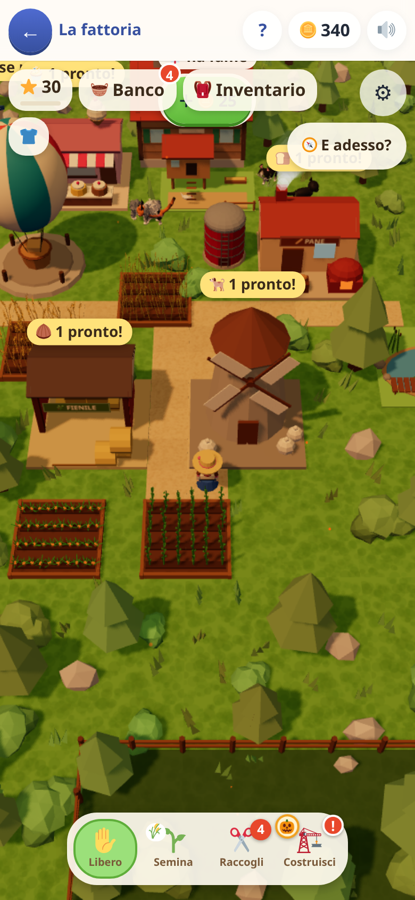
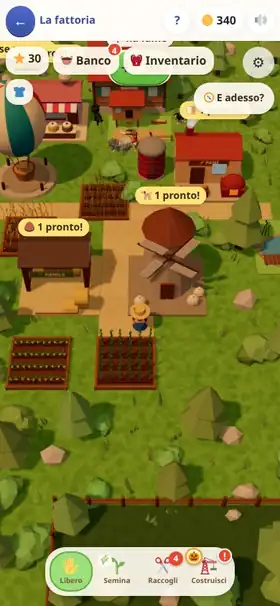

[← torna al README](../../README.md)

# 🚜 La fattoria

**Dove finiscono le monete guadagnate negli altri giochi.** Non ci sono domande, e non ce ne saranno: è il posto dove si spende, e
per questo è il motivo per cui si torna a fare esercizi. È una fattoria da girare, vista dall'alto in 3D: invece di toccare le cose
da lontano il contadino **ci va a piedi** e fa il suo lavoro: si china a seminare, taglia il grano con la falce, alza l'ascia sugli
alberi, dà da mangiare alle bestie.

 

## Cosa si fa

- **Si allarga e si costruisce.** I terreni si comprano a lotti dentro un recinto basso; i pezzi si trascinano dal menu, si pagano
  quando li lasci sulla mappa (niente conferme), si spostano tenendoli premuti, le strade si disegnano col dito; alberi, sassi e
  cespugli si tolgono toccandoli, per poche monete. Più di duecento decorazioni, da mettere dove si vuole.
- **Si coltiva.** Sedici colture, dal grano al riso, che crescono **col tempo vero** (minuti): si semina e si raccoglie armando
  l'azione e passando sui campi. Il raccolto va nei silos, e da lì nelle macchine.
- **Le macchine in catena.** Il mulino fa la farina, il fienile il mangime delle bestie, il panificio il pane e la torta, il
  caseificio burro e formaggio, il telaio la stoffa, la sartoria il maglione… Ogni ricetta prende qualche pezzo e ne dà uno solo.
- **Gli animali.** Pecore, galline, mucche, anatre, maiali, capre, conigli, alpaca, asini e api mangiano il mangime giusto e danno
  lana, uova, latte, miele. Le bestie di casa (Watson il cane, i gatti, e un beagle, un gatto rosso, un coniglio, un pappagallo da comprare) hanno
  fame, voglia di giocare e il pelo da spazzolare, e si vestono con cappellini e occhiali che si vedono mentre girano.
- **Chi chiede.** Quello che si produce serve: al banco degli ordini, alle botteghe del paese, alla mongolfiera che scende dal cielo
  a caricare casse, ai vicini col trattore. Consegnare fa salire il **livello della fattoria**, e ogni livello apre una cosa nuova.
- **Il mare, i laghi e la pesca.** A ovest c'è il mare, a est laghi grandi che si scoprono comprando i terreni vicini; da un molo il
  contadino lancia la lenza, e il pesce serve alla friggitoria e al sushi bar.

## Come si tocca

Un tocco manda il contadino: sul prato ci va, su una cosa ci va e la fa. Un dito che scorre sposta la mappa, due dita zoomano;
tenere premuto apre «Costruisci qui». Quando una cosa non si può fare il gioco non dice solo «no»: dice cosa fare adesso, e dove
può porta il tasto per farlo.

## Cosa allena

Non allena una materia di scuola, e non lo pretende: è il premio degli esercizi fatti altrove. Quello che chiede è **pianificare**.
Ogni ricetta prende qualche pezzo e ne dà uno solo, quindi «quanti me ne servono» ha una risposta che si conta sulle dita: per tre
uova ci vogliono sei sacchi di becchime, cioè dodici campi di grano. Una catena lunga (l'erba che diventa foraggio, lana, stoffa,
maglione) si impara a risalire da soli, e «🌳 Come si fa» la mostra quando serve. C'è anche la pazienza: i campi crescono in minuti
veri, e la fattoria si organizza per lavorare da sola mentre si fa altro.

## Note per i genitori

- **Non ci sono domande.** Le monete si guadagnano solo facendo esercizi negli altri giochi; qui si spendono, col salvadanaio vero.
  Niente si vende per monete: se il banco comprasse il grano, la strada più corta per le monete non passerebbe più da nessuna
  tabellina. Le consegne pagano esperienza, cioè livelli.
- **Niente marcisce e niente si perde.** Un campo maturo aspetta per sempre, le bestie hanno fame ma non muoiono, quello che si
  mette via va nel magazzino e si ripiazza gratis. È un posto dove tornare, non un dovere.
- **Sale piano, apposta.** Settanta livelli: il secondo sono tre quarti d'ora di esercizi, l'ultimo circa duecento ore. Spalmato su
  mesi, per un posto che si guarda pochi minuti al giorno.
- **Chi aveva la fattoria di prima** (quella disegnata in 2D, tolta il 31 ottobre 2026) la ritrova qui alla prima apertura: livello,
  roba, bestie col loro nome; i pezzi aspettano nel magazzino, da rimettere gratis dove si vuole.
- **Si spegne tutta o niente**, dalla schermata dei grandi come ogni gioco ([la pagina dei genitori](../genitori/README.md)).
- A Halloween e a Natale la fattoria cambia faccia da sola; zucche, albero e pupazzo di neve si comprano.
- Sui telefoni vecchi può essere lenta: c'è un pannello ⚙ con la qualità. Senza WebGL 2 il gioco lo dice e si torna in home.

Il resto (le regole, i numeri, i perché) sta nei file di questa cartella: [README.md](README.md).
