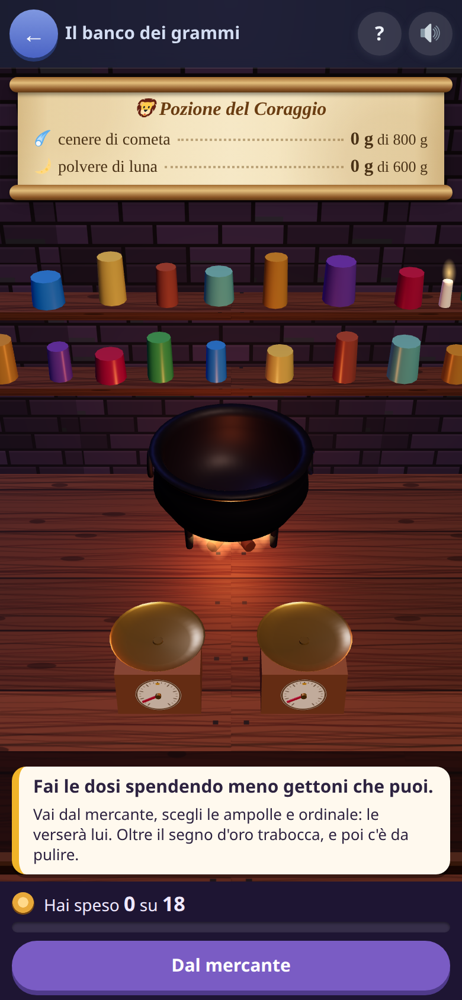

[← torna al README](../../README.md)

# ⚗️ Il laboratorio delle pozioni

*Chili, metri e litri — ma a gettoni contati.* La ricetta chiede tanti
ingredienti, il mercante li vende in ampolle scritte come gli pare: si legge
il listino, si ordinano le ampolle giuste spendendo poco, e lui le versa.

 

## Come è fatto

Tre famiglie di misure, ognuna con le sue unità e il suo strumento:

| | famiglia | unità | si misura con |
|---|---|---|---|
| ⚖️ | i pesi | kg · hg · g | la bilancia col quadrante |
| 📏 | le lunghezze | m · dm · cm | il metro in piedi |
| 🫗 | i liquidi | l · dl · ml | il cilindro graduato |

**Una tappa è una pozione, col suo nome.** Sulla pergamena ci sono gli
ingredienti con la loro dose, «2 kg di polvere di luna», e sul banco uno
strumento per ognuno col segno d'oro dove arrivare. Sotto, la ricetta a punti dice cosa fare con la roba comprata: si trascina nel
calderone o nel mortaio, e si pesta,
si mescola, si accende il fuoco, si diluisce. Una mossa fuori tempo fa un pasticcio.

**Dal mercante.** Il suo rotolo elenca gli ingredienti della ricetta, con
quattro targhette a testa: quanto c'è nell'ampolla e il prezzo in gettoni. Le ampolle grandi costano meno al chilo, quindi conviene sempre la più
grande che ci sta. Ma per sapere cosa ci sta bisogna sapere a cosa corrisponde
quello che c'è scritto: il mercante scrive «2000 g», «20 hg», «2 kg» come gli
pare. **La conversione non è il compito, è quello che serve per scegliere**,
come quando si sommano monete diverse.

**Il trucco del mercante.** Spesso la stessa quantità sta sul listino due volte,
in due unità, e una costa un gettone in più. Chi riconosce che sono la stessa
cosa risparmia.

**L'ordine.** Si scelgono fino a cinque ampolle e si ordina: si paga, e il mercante
le versa una alla volta. Lo scontrino dice prima quanto costa, e ogni ordine ha un
gettone di spedizione: una cosa per volta costa di più, tutto insieme chiede di
fare i conti prima di vedere. Quando uno strumento arriva all'oro finisce nel
calderone, e il brodo sale e cambia colore.

**Se trabocca.** Oltre il segno d'oro l'ampolla è persa, e resta una macchia da
pulire: un gettone alla spugna. Il cartello dice subito perché, coi numeri di
quel momento: «C'erano 1000 g: 1000 g + 1000 g = 2000 g, oltre la tacca di
1500 g. Ne mancavano 500 g».

## La scaletta: una cosa nuova per volta

**Prima si impara il gesto, poi una cosa nuova per volta, e ogni cosa nuova si
spiega finché serve. L'uguaglianza fra le unità resta scritta in tutte le tappe:
a memoria si va solo nel calderone senza fondo.** Nove gradini, gli stessi per le tre
famiglie:

| | gradino | cosa chiede | aiuto |
|---|---|---|---|
| 1 | il banco | «500 g», e il listino in grammi | come si gioca |
| 2 | arriva il chilo | «1 kg», e il listino in grammi | il conto sotto ogni targhetta |
| 3 | chili interi | 2 kg, 5 kg | la regola: 1 kg = 1000 g |
| 4 | chili e grammi insieme | «1500 g», cioè 1 kg e 500 g | il conto sotto ogni targhetta |
| 5 | chili e grammi da soli | le stesse, e «3500 g» | la regola |
| 6 | etti sul listino | 8 kg, 12 kg, e arrivano gli etti | il conto sotto ogni targhetta |
| 7 | chili, etti e grammi | la ricetta parla in tre unità | la regola |
| 8 | al contrario | «6000 g», e il mercante vende a chili | il conto sotto ogni targhetta |
| 9 | su e giù per la scala | tutto insieme | la regola |

Le lunghezze rifanno la scaletta con metri, decimetri e centimetri, sempre in
numeri interi: si pensa alla conversione, non ai conti. I liquidi la rifanno con
litri, decilitri e millilitri, ed è lì che arriva la virgola, dalla tappa 22,
quando a scuola la si è già fatta: 0,5 l, 1,5 l. Poi due tappe in cui arriva di tutto: pesi,
lunghezze e liquidi nella stessa pozione. Ventinove tappe in tutto, e i gettoni
in più si stringono andando avanti.

## Senza fretta e senza cuori

Il tempo non è un avversario: una barra che scende sopra un cartello da leggere
insegna a non leggere. **La tappa si finisce sempre**, anche in rosso, e a
cambiare sono le stelle: tre al minimo dei gettoni, due con poco di più, una
comunque. Le monete sono tre per ogni ingrediente finito senza traboccare; a
fine tappa non c'è un premio in più.

## Cosa allena

Le unità di misura e le conversioni fra multipli e sottomultipli, nei due
versi, e confrontare quantità scritte in modo diverso.

## Note per i genitori

Questo gioco **si nasconde da solo** se hai spento le misure o le
conversioni in *Impostazioni → Giochi e domande*: qui le misure non sono un
tipo di domanda fra tanti, sono tutto il gioco. Compare in home dai sette
anni e mezzo; a un bambino più grande le prime tappe dei pesi nascono già
aperte, e può cominciare da dove gli serve.

Per chi ci lavora: [le regole](regole.md).
